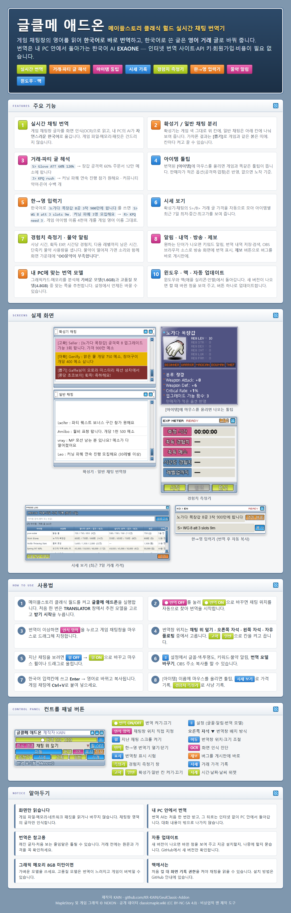

# 글클메 애드온 (GeulClassic Addon)

메이플스토리 클래식 월드의 게임 채팅을 **실시간으로 한국어 번역**해 주는 Windows 프로그램입니다.
한국어로 쓴 글은 영어 거래 글로 바꿔 줍니다. 번역은 PC 안에서만 동작하는 오프라인 AI라서
인터넷 번역 사이트, API 키, 회원가입이 필요 없습니다.

## 다운로드 · 설치

1. [Releases](https://github.com/KR-KAIN/GeulClassic-Addon/releases)에서 최신 `GeulClassic-Addon-Setup-v….exe`를 받습니다.
2. 실행하면 설치됩니다. 관리자 권한이 필요 없고, 시작 메뉴와 바탕화면(선택)에 바로가기가 생깁니다.
3. 메이플스토리 클래식 월드를 켠 뒤 **글클메 애드온**을 실행하고, 패널의 `● 번역 OFF`를 눌러 켭니다.

> 서명되지 않은 개인 제작 프로그램이라 Windows SmartScreen이 "알 수 없는 게시자" 경고를 띄울 수 있습니다.
> `추가 정보 → 실행`을 누르면 설치됩니다.

설정·번역 내역·시세 기록은 `%LOCALAPPDATA%\KAINMapleTranslator`에 저장되며, 프로그램을 제거해도 남습니다.

## 주요 기능

| 기능 | 설명 |
| --- | --- |
| 실시간 채팅 번역 | 게임 채팅창을 화면 인식(OCR)으로 읽어 한국어로 번역. 확성기와 일반 채팅을 나눠 표시 |
| 거래·파티 글 해석 | `S> Glove ATT 60% 120k` → 장갑 공격력 60% 주문서 12만 메소에 팝니다 / `J> KPQ rush` → 커닝 파퀘 연속 진행 참가 원해요 |
| 아이템 툴팁 | 번역된 `[아이템]`에 마우스를 올리면 게임과 같은 툴팁. 판매자가 적은 옵션 반영 |
| 한→영 입력기 | `노가다 목장갑 8공 3작 900만에 팝니다` → `S> WG 8 att 3 slots 9m`, `감사합니다` → `ty` 처럼 바꿔 자동 복사 |
| 시세 보기 | 거래 글 가격을 자동으로 모아 아이템별 최근 7일 최저·중간·최고가 |
| 경험치 측정기 | 측정 시간, 획득 경험치, 획득 메소, 시간당 경험치, 레벨업까지 (정사각형 창) |
| 물약 알리미 | 단축키 아래 줄의 체력·마나 물약이 정한 개수 이하가 되면 알림음 (`≡ 설정 → 알림 · 시세`) |
| 시계 · 날짜 · 날씨 | 퀘스트 알림이 모양의 위젯. 세로 3줄 또는 가로 한 줄, 배경 투명도와 날씨 지역 설정 |
| 알림 · 내역 · 방송 | 키워드 알림, 번역 내역 저장·검색, OBS 브라우저 소스. 모든 애드온 창을 OBS `윈도우 캡처`에서 이름으로 선택 가능 |
| 저사양 모드 | 게임·OBS가 느려지는 PC나 원컴 방송용 (`≡ 설정 → 자석 · OCR`) |
| 해상도 · 패널 | 창모드 1280x720 ~ 2560x1440 자동 맞춤. 컨트롤 패널은 `_`로 접거나 `↓`로 트레이에 넣고, 한→영 번역기는 X로 닫고 `번역` 버튼으로 다시 엶 |
| 채팅 칸 | 확성기·일반 채팅은 각각 따로 옮기고 아무 가장자리에서나 크기 조절. X나 패널의 `고확`·`일반` 버튼으로 끄고 켬. 파티 채팅 `[파티]`, 귓말 `[귓말]`, 뽑기 `[뽑기]` |
| 자동 업데이트 | 새 버전이 나오면 바뀐 점을 보여 주고 지금 설치할지, 나중에 할지 물어봄 (`≡ 설정`에서 끌 수 있음) |

프로그램 안에서도 `≡ 설정 → 사용법 · 기능 안내 보기`로 위 안내를 볼 수 있습니다.

## 안전 · 개인정보

- 게임 파일, 메모리, 네트워크 패킷을 읽거나 바꾸지 않습니다. 게임 창의 채팅 영역 화면만 인식합니다.
- 번역 모델이 프로그램에 들어 있어 대화 내용이 외부로 나가지 않습니다.
- 인터넷은 새 버전 확인(GitHub 릴리스 페이지), 설정에서 직접 고른 글꼴 받기, 시계 위젯을 켰을 때의 날씨(대략 위치: ipapi.co, 날씨: Open-Meteo)에만 씁니다. 업데이트 설치 파일은 GitHub에 적힌 SHA256 값과 같을 때만 실행합니다.
- 번역은 참고용입니다. 거래 전에는 원문과 가격을 꼭 확인하세요.

## 소스 코드

이 저장소는 설치 파일 배포와 자동 업데이트 전용입니다. 프로그램 소스 코드는 공개하지 않습니다.
설치 파일은 [Releases](https://github.com/KR-KAIN/GeulClassic-Addon/releases)에서 받을 수 있고, 프로그램 안의 자동 업데이트도 이곳의 릴리스를 확인합니다.

## 데이터 · 저작권

- MapleStory와 게임 그래픽(버튼, 창, 아이콘, 아이템 정보)의 저작권은 NEXON에 있습니다. 이 프로그램은 비상업적 팬 제작 도구이며 NEXON과 관련이 없습니다.
- 게임 버튼·툴팁·아이템 데이터는 공개 WZ 브라우저 [maplestory.io](https://maplestory.io)의 MapleStory Classic World 데이터에서 가져옵니다.
- Classic World 공개 데이터: [classicmaple.wiki](https://classicmaple.wiki) — CC BY-NC-SA 4.0, 비상업적 이용 (`OPEN-DATA-LICENSE.md`).
- 화면 인식: [RapidOCR](https://github.com/RapidAI/RapidOCR) / PaddleOCR 모델.
- 번역: [Argos Translate](https://github.com/argosopentech/argos-translate) 오프라인 모델, [CTranslate2](https://github.com/OpenNMT/CTranslate2).

제작자 KAIN
