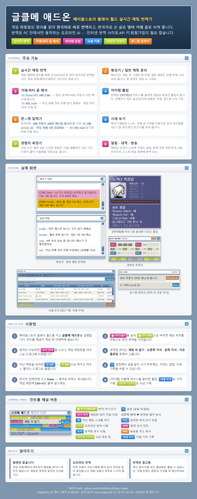

# 글클메 애드온 (GeulClassic Addon)

메이플스토리 클래식 월드의 게임 채팅을 **실시간으로 한국어 번역**해 주는 Windows 프로그램입니다.
한국어로 쓴 글은 영어 거래 글로 바꿔 줍니다. 번역은 PC 안에서만 동작하는 오프라인 AI라서
인터넷 번역 사이트, API 키, 회원가입이 필요 없습니다.

## 다운로드 · 설치

1. [Releases](https://github.com/KR-KAIN/GeulClassic-Addon/releases)에서 최신 `GeulClassic-Addon-Setup-v….exe`를 받습니다.
2. 실행하면 설치됩니다. 관리자 권한이 필요 없고, 시작 메뉴와 바탕화면(선택)에 바로가기가 생깁니다.
3. 메이플스토리 클래식 월드를 켠 뒤 **글클메 애드온**을 실행하고, 패널의 `● 번역 OFF`를 눌러 켭니다.

> 서명되지 않은 개인 제작 프로그램이라 Windows SmartScreen이 "알 수 없는 게시자" 경고를 띄울 수 있습니다.
> `추가 정보 → 실행`을 누르면 설치됩니다.

설정·번역 내역·시세 기록은 `%LOCALAPPDATA%\KAINMapleTranslator`에 저장되며, 프로그램을 제거해도 남습니다.

## 주요 기능

| 기능 | 설명 |
| --- | --- |
| 실시간 채팅 번역 | 게임 채팅창을 화면 인식(OCR)으로 읽어 한국어로 번역. 확성기와 일반 채팅을 나눠 표시 |
| 거래·파티 글 해석 | `S> Glove ATT 60% 120k` → 장갑 공격력 60% 주문서 12만 메소에 팝니다 / `J> KPQ rush` → 커닝 파퀘 연속 진행 참가 원해요 |
| 아이템 툴팁 | 번역된 `[아이템]`에 마우스를 올리면 게임과 같은 툴팁. 판매자가 적은 옵션 반영 |
| 한→영 입력기 | `60% 주문서 200만 메소에 팝니다` → `S> 60% scroll 2m` 으로 바꿔 자동 복사 |
| 시세 보기 | 거래 글 가격을 자동으로 모아 아이템별 최근 7일 최저·중간·최고가 |
| 경험치 측정기 | 사냥 시간, 획득 EXP, 시간당 경험치, 다음 레벨까지, 물약 사용량 |
| 알림 · 내역 · 방송 | 키워드 알림, 번역 내역 저장·검색, OBS 브라우저 소스 |

프로그램 안에서도 `≡ 설정 → 사용법 · 기능 안내 보기`로 위 안내를 볼 수 있습니다.

## 안전 · 개인정보

- 게임 파일, 메모리, 네트워크 패킷을 읽거나 바꾸지 않습니다. 게임 창의 채팅 영역 화면만 인식합니다.
- 번역 모델이 프로그램에 들어 있어 대화 내용이 외부로 나가지 않습니다.
- 번역은 참고용입니다. 거래 전에는 원문과 가격을 꼭 확인하세요.

## 소스에서 빌드하기

Windows 10/11 x64에서:

1. 이 저장소를 받습니다.
2. `BUILD-WINDOWS.bat`을 실행합니다. Python 3.12 설치(필요 시), 패키지 설치, 테스트,
   번역 모델(약 230MB) 내려받기, 실행 파일 빌드까지 자동으로 진행하고 `dist\글클메 애드온\`에 결과를 만듭니다.
3. 설치 파일이 필요하면 [Inno Setup 6](https://jrsoftware.org/isinfo.php)을 설치한 뒤 `installer\BUILD-INSTALLER.bat`을 실행합니다.

### 저장소에 없는 파일

다음은 일부러 저장소에서 뺐습니다. 없어도 빌드는 되며, 해당 데이터가 필요한 테스트 58개는 자동으로 건너뜁니다
(`scripts/run_tests.py`, 목록은 `tests/private_data_tests.txt`).

- `tests/fixtures/` — 실제 게임 화면 캡처(다른 플레이어 닉네임이 보임)
- `resources/meowdb/` — meowdb.com 아이템 한글명(재배포에 운영자 허가 필요). 없어도 아이템 한글명은 게임 자체 데이터로 나옵니다.
- `resources/models/*.argosmodel` — 빌드 때 자동으로 내려받음(파일당 100MB 초과)

## 데이터 · 저작권

- MapleStory와 게임 그래픽(버튼, 창, 아이콘, 아이템 정보)의 저작권은 NEXON에 있습니다. 이 프로그램은 비상업적 팬 제작 도구이며 NEXON과 관련이 없습니다.
- 게임 버튼·툴팁·아이템 데이터는 공개 WZ 브라우저 [maplestory.io](https://maplestory.io)의 MapleStory Classic World 데이터에서 가져옵니다 (`scripts/fetch_button_ui.py`, `scripts/fetch_tooltip_ui.py`, `scripts/fetch_item_info.py`).
- Classic World 공개 데이터: [classicmaple.wiki](https://classicmaple.wiki) — CC BY-NC-SA 4.0, 비상업적 이용 (`OPEN-DATA-LICENSE.md`).
- 화면 인식: [RapidOCR](https://github.com/RapidAI/RapidOCR) / PaddleOCR 모델 (`resources/ocr/licenses`).
- 번역: [Argos Translate](https://github.com/argosopentech/argos-translate) 오프라인 모델, [CTranslate2](https://github.com/OpenNMT/CTranslate2).

제작자 KAIN
